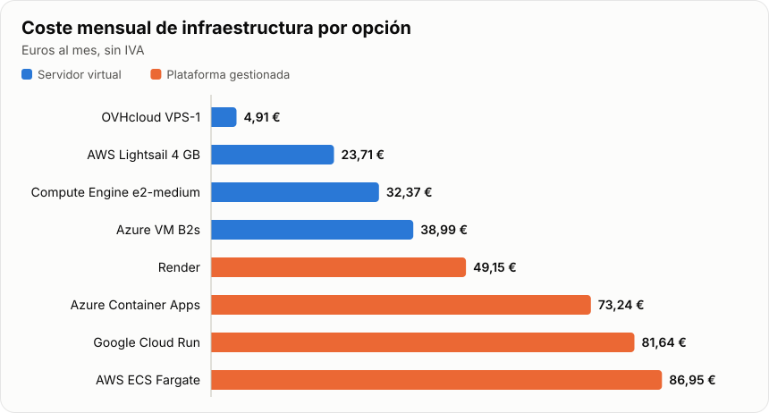
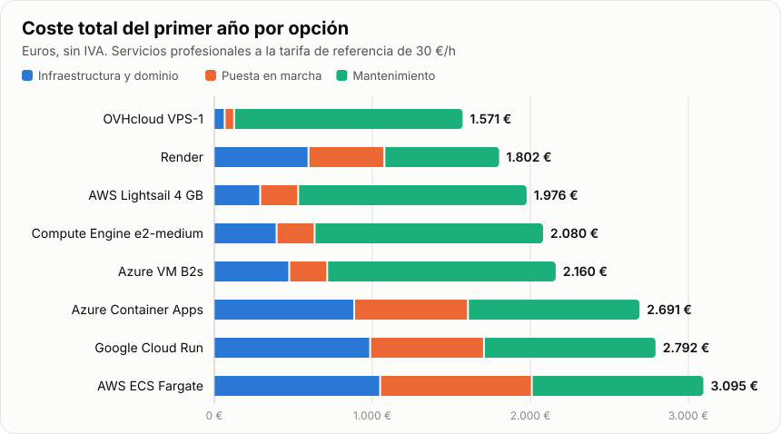
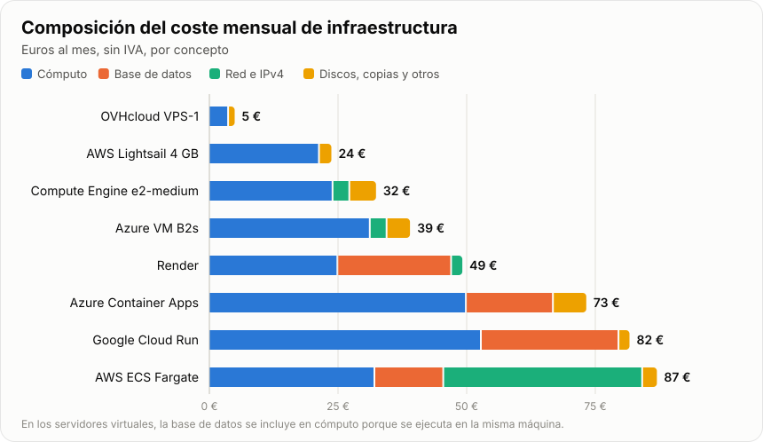
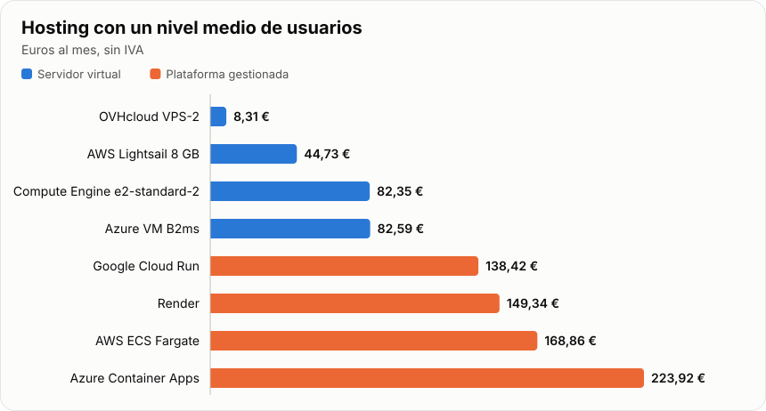
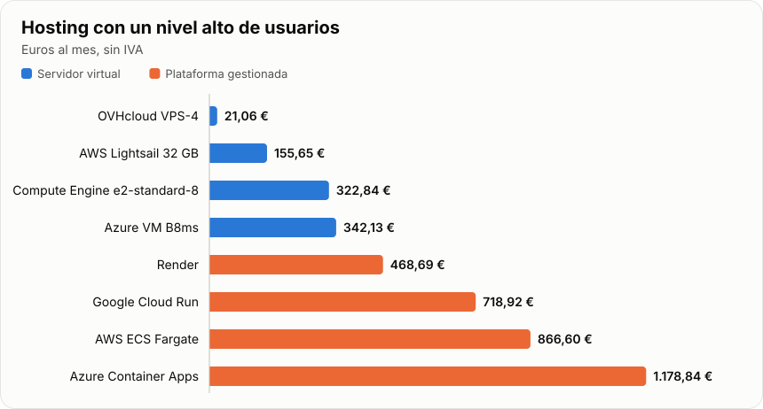

# Presupuesto de puesta en producción de Umbral

Fecha: 4 de noviembre de 2026. Precios sin IVA, salvo donde se indica otra cosa.

Este presupuesto calcula cuánto costaría poner en producción y mantener Umbral, la plataforma de gestión de incidentes de ciberseguridad, en AWS, Render, Azure y Google Cloud. También incluye OVHcloud, el proveedor donde la aplicación está desplegada ahora. Se calcula para tres niveles de usuarios: bajo, medio y alto.

AWS, Azure y Google Cloud se presupuestan de dos formas, porque el precio y el trabajo cambian mucho según cómo se use cada proveedor:

- **Servidor virtual:** se alquila una máquina y se ejecuta en ella el `docker-compose.yml` actual, como se hace hoy. Es lo más barato y no obliga a cambiar la aplicación, pero el sistema operativo, las actualizaciones y las copias corren por cuenta de quien la mantiene.
- **Plataforma gestionada:** cada servicio se ejecuta por separado y la base de datos la administra el proveedor. Hay menos trabajo de sistemas, pero el hosting cuesta más y hay que adaptar el despliegue.

## Niveles de usuarios

El presupuesto se calcula para tres niveles. Las cifras de usuarios son estimaciones de capacidad, no resultados medidos: la aplicación todavía no ha pasado una prueba de carga. Por eso los niveles medio y alto incluyen horas para hacerla.

| Nivel | Usuarios registrados | Usuarios simultáneos | Tráfico al mes | Base de datos | Disponibilidad |
|---|---:|---:|---:|---:|---|
| Bajo | Hasta 50 | Unos 10 | 20 GB | 20 GB | Una zona |
| Medio | Hasta 500 | Unos 100 | 200 GB | 50 GB | Una zona |
| Alto | Hasta 5.000 | Unos 500 | 1 TB | 100 GB | Alta disponibilidad en plataformas; una máquina en servidores |

**Nivel bajo.** Es el presupuesto de la siguiente sección. Cubre el uso actual de evaluación y demostración, con la aplicación tal como está.

**Nivel medio.** No hace falta cambiar el código. Se amplían la memoria y la base de datos, pero la API sigue siendo un único proceso, por lo que aprovecha como máximo un núcleo de CPU. Ese es el límite real de este nivel: una máquina con más núcleos no hace que la API atienda más peticiones.

**Nivel alto.** Para atender a unos 500 usuarios simultáneos hacen falta varias réplicas de la API, y hoy solo funciona una, porque el límite de peticiones y el tiempo real están en la memoria del proceso. Se han presupuestado **40 horas (1.200 €)** para llevar ambos a Redis y probar el cambio. Sin ese trabajo solo se puede ejecutar una réplica, y se ha estimado que una no basta para este nivel. La prueba de carga debe confirmarlo: si una réplica fuera suficiente, ese coste desaparecería.

En los dos niveles nuevos, la puesta en marcha añade una prueba de carga: 4 horas en el medio y 8 en el alto. El mantenimiento también sube, porque hay más que supervisar.

| Opción | Hosting al mes, bajo | Hosting al mes, medio | Hosting al mes, alto | Primer año, bajo | Primer año, medio | Primer año, alto |
|---|---:|---:|---:|---:|---:|---:|
| OVHcloud | 4,91 € | 8,31 € | 21,06 € | 1.571 € | 2.452 € | 5.365 € |
| AWS Lightsail | 23,71 € | 44,73 € | 155,65 € | 1.976 € | 3.069 € | 7.160 € |
| Google Compute Engine | 32,37 € | 82,35 € | 322,84 € | 2.080 € | 3.520 € | 9.166 € |
| Azure VM | 38,99 € | 82,59 € | 342,13 € | 2.160 € | 3.523 € | 9.398 € |
| Render | 49,15 € | 149,34 € | 468,69 € | 1.802 € | 3.484 € | 9.716 € |
| Azure Container Apps | 73,24 € | 223,92 € | 1.178,84 € | 2.691 € | 4.979 € | 19.198 € |
| Google Cloud Run | 81,64 € | 138,42 € | 718,92 € | 2.792 € | 3.953 € | 13.679 € |
| AWS ECS Fargate | 86,95 € | 168,86 € | 866,60 € | 3.095 € | 4.558 € | 15.691 € |

El primer año incluye la puesta en marcha, doce meses de hosting y mantenimiento, y 12 € de dominio.

Con usuarios medios, OVHcloud sigue siendo la más barata en hosting. Con usuarios altos también, pero los servidores virtuales mantienen todo en una sola máquina: si esa máquina falla, el servicio se interrumpe, por mucha capacidad que tenga. La tolerancia a fallos solo se incluye en las plataformas gestionadas.

## Precios para un nivel bajo de usuarios

| Opción | Puesta en marcha | Hosting al mes | Mantenimiento al mes | Primer año | Años siguientes |
|---|---:|---:|---:|---:|---:|
| OVHcloud VPS-1 (servidor) | 60 € | 4,91 € | 120 € | 1.571 € | 1.511 € |
| AWS Lightsail (servidor) | 240 € | 23,71 € | 120 € | 1.976 € | 1.736 € |
| Google Compute Engine (servidor) | 240 € | 32,37 € | 120 € | 2.080 € | 1.840 € |
| Azure VM (servidor) | 240 € | 38,99 € | 120 € | 2.160 € | 1.920 € |
| Render (plataforma) | 480 € | 49,15 € | 60 € | 1.802 € | 1.322 € |
| Azure Container Apps (plataforma) | 720 € | 73,24 € | 90 € | 2.691 € | 1.971 € |
| Google Cloud Run (plataforma) | 720 € | 81,64 € | 90 € | 2.792 € | 2.072 € |
| AWS ECS Fargate (plataforma) | 960 € | 86,95 € | 90 € | 3.095 € | 2.135 € |

El primer año suma la puesta en marcha, doce meses de hosting y mantenimiento, y 12 € de dominio. Los años siguientes no incluyen la puesta en marcha. Con el IVA del 21 %, el hosting va de 5,94 € al mes en OVHcloud a 105,21 € al mes en AWS Fargate.

OVHcloud es la opción más barata, tanto en hosting como en el primer año. Si el mantenimiento se paga, Render tiene el menor coste acumulado a partir del tercer año, porque necesita menos horas al mes. Si lo hace el propio autor sin cobrarlo, solo cuenta el hosting y el orden es el de la columna de hosting.

## Qué hay que alojar

Umbral está formado por seis servicios. La interfaz web es una aplicación Angular servida con nginx, y la API está hecha con FastAPI. Los datos se guardan en PostgreSQL 17, que no está expuesto a internet. El señuelo es un honeypot de registro con dominio propio, que recibe sondeos reales y los envía a la API. El generador produce eventos de demostración para el panel, y el servicio de copias hace un `pg_dump` diario y conserva los últimos siete días.

Tres características del código influyen directamente en el precio:

- **La API no puede apagarse cuando no hay usuarios.** El generador emite un evento cada 1,5 a 6 segundos, sin pausa (`senuelo/generador.py`), así que la API siempre tiene trabajo. Por eso las plataformas que cobran por uso no ahorran tanto como cabría esperar.
- **La API funciona con una sola réplica.** El límite de peticiones y el tiempo real se guardan en la memoria del proceso (`backend/app/limitador.py` y `backend/app/tiempo_real.py`). Para repartir la carga entre varias copias hay que modificar la aplicación y añadir un almacén compartido, como Redis. Ese trabajo solo se incluye en el nivel alto.
- **La base de datos no crece sin límite.** Los eventos se borran a los 30 días (`backend/app/config.py`). Con unos 23.000 eventos al día se acumulan unos 690.000, que a razón de 1 KB por evento ocupan alrededor de 1 GB. Por eso se han contratado 20 GB, salvo en Azure, donde el mínimo es de 32 GB.

## Con qué supuestos se ha calculado

En el nivel bajo se ha previsto un uso reducido: pocos usuarios y unos 20 GB de tráfico saliente al mes. Todo se aloja en la Unión Europea, porque la aplicación guarda direcciones IP y estas pueden ser datos personales. No hay alta disponibilidad: si falla la zona o el servidor, el servicio se interrumpe, igual que en el despliegue actual.

Los servidores virtuales se han dimensionado con 2 vCPU y 4 GB de RAM. Tienen que ejecutar los seis servicios y Dokploy, cuyo mínimo son 2 GB de RAM. En las plataformas, cada contenedor lleva 0,25 vCPU y 0,5 GB. Son estimaciones, porque aún no se ha medido el consumo real de la aplicación.

Los dólares se han convertido con el tipo del BCE del 3 de noviembre de 2026: 1 € = 1,1179 USD. El mes de hosting se ha calculado con 730 horas.

## Puesta en marcha y mantenimiento

Las horas son una estimación y están calculadas a 30 €/h. Son la parte del presupuesto que más conviene ajustar, porque en todas las opciones la mano de obra cuesta más que el hosting.

**En un servidor virtual**, la puesta en marcha lleva unas 8 horas (240 €): preparar y bastionar la máquina, instalar Dokploy, configurar el DNS, los secretos y el login con Google y GitHub, organizar las copias y probar que se pueden restaurar. En OVHcloud se reduce a unas 2 horas (60 €), porque la aplicación ya está desplegada y solo faltan el dominio propio, el ajuste del login, las copias y la prueba de restauración.

El mantenimiento de un servidor se ha estimado en 4 horas al mes (120 €). Incluye parches del sistema, Docker y Dokploy, actualización de dependencias, revisión de copias y alertas, y una prueba de restauración.

**En una plataforma gestionada**, la puesta en marcha es mayor porque hay que adaptar el enrutado y las variables, crear los servicios, cambiar el despliegue continuo, migrar los datos y volver a pasar las pruebas. Se han estimado 16 horas en Render (480 €), 24 en Azure Container Apps y Cloud Run (720 €) y 32 en AWS Fargate (960 €), que además requiere configurar la red y el balanceador.

El mantenimiento baja porque el proveedor se encarga del sistema operativo: 2 horas al mes en Render (60 €) y 3 en las demás plataformas (90 €).

Además, un dominio propio cuesta unos 12 € al año (estimado), porque la aplicación usa ahora una dirección de `sslip.io`. Los certificados TLS no tienen coste. GitHub Actions tampoco, mientras no se supere la cuota gratuita. No hace falta un servicio de correo, porque la aplicación no envía correos.

## Coste de hosting por proveedor, nivel bajo

### AWS

**Lightsail: 26,50 USD al mes (23,71 €).** Es el servidor virtual sencillo de AWS, con precio cerrado. Incluye 2 vCPU, 4 GB de RAM, 80 GB de disco SSD, 4 TB de tráfico y la dirección IPv4.

- Servidor: 24,00 USD
- Copia externa en almacenamiento de objetos de 5 GB: 1,00 USD
- Instantáneas del servidor, unos 30 GB a 0,05 USD/GB: 1,50 USD

Es la opción más barata de los tres grandes proveedores y la factura es muy previsible. La aplicación no cambia y se conserva toda la protección actual de los contenedores. A cambio, todo depende de una sola máquina y las actualizaciones quedan a cargo de quien la mantiene. Las tarifas son oficiales; solo el volumen de las instantáneas es estimado.

**ECS Fargate, ALB y RDS: 97,21 USD al mes (86,95 €).** Es la forma de usar AWS con servicios gestionados, y la más cara del presupuesto.

- Cuatro contenedores en Fargate: 36,04 USD
- Balanceador de carga ALB: 18,40 USD, más unos 2,92 USD de uso
- Seis direcciones IPv4 públicas: 21,90 USD
- Base de datos RDS `db.t4g.micro` con 20 GB: 14,95 USD
- Registro de imágenes y logs: 3,00 USD (estimado)

Destaca el coste de la red: el balanceador y las direcciones IP suman más que los propios contenedores. Las direcciones son necesarias porque los contenedores están en una subred pública; la alternativa, un NAT Gateway, costaría más. Esta opción ofrece la base de datos gestionada y es la que más margen da para crecer, pero es también la que más trabajo inicial exige. Tarifas oficiales de la región de Irlanda.

### Render

**Render: 54,95 USD al mes (49,15 €).** Es una plataforma pensada para desplegar sin administrar servidores, y la más sencilla de las gestionadas. No admite `docker-compose`, así que cada servicio se crea por separado.

- Cuatro servicios de 512 MB a 7 USD (web, API, señuelo y generador): 28,00 USD
- PostgreSQL con 1 GB de RAM: 19,00 USD
- 19 GB adicionales de almacenamiento a 0,30 USD: 5,70 USD
- 15 GB de tráfico por encima de lo incluido, a 0,15 USD: 2,25 USD
- Plan Hobby: sin coste, con 5 GB de tráfico y recuperación de la base de datos a 3 días

Con clientes reales conviene el plan Pro: añade 25 USD al mes, amplía la recuperación a 7 días e incluye 25 GB de tráfico, con lo que el total sube a unos 77,70 USD al mes.

Su ventaja es que requiere muy poco mantenimiento. Sus inconvenientes son que hay que adaptar el enrutado y que no se ha encontrado una forma de mantener los controles `read_only` y `cap_drop` de los contenedores, algo que falta verificar. Las tarifas son oficiales; el volumen de tráfico es estimado.

### Azure

**Máquina virtual B2s: 43,59 USD al mes (38,99 €).** Tiene las mismas características prácticas que las demás opciones de servidor: 2 vCPU y 4 GB de RAM, en la región West Europe.

- Servidor: 35,04 USD
- Disco SSD de 64 GB: 4,80 USD
- Dirección IPv4 estática: 3,65 USD
- Copia externa de unos 5 GB: 0,10 USD

La aplicación no cambia, pero es el servidor más caro del presupuesto porque el disco y la dirección IP se pagan aparte. Las tarifas son oficiales. El tráfico no suma coste, porque los 20 GB entran en los 100 GB gratuitos al mes.

**Container Apps y PostgreSQL Flexible: 81,88 USD al mes (73,24 €).** Es la plataforma de contenedores de Azure, que cobra por segundo de uso.

- Contenedores: 55,91 USD, ya descontadas las cuotas gratuitas
- PostgreSQL B1ms: 14,53 USD
- 32 GB de almacenamiento: 4,38 USD
- Registro de imágenes: 5,06 USD
- Logs: 2,00 USD (estimado)

Se ha calculado con la API y el generador siempre activos, y con la web y el señuelo activos un 15 % del tiempo. El señuelo podría perder algún sondeo mientras arranca. Esta es la opción con más incertidumbre: la lista de precios incluye un concepto `Environment Management Hour` de 0,10 USD/h, unos 73 USD al mes. Se ha supuesto que no se aplica a este plan, pero no se ha podido verificar. Si se aplicara, pasaría a ser la opción de hosting más cara.

### Google Cloud

**Compute Engine `e2-medium`: 36,19 USD al mes (32,37 €).** Es un servidor con 2 vCPU compartidas y 4 GB de RAM, en la región de Bélgica.

- Servidor: 26,94 USD
- Disco SSD de 40 GB: 4,00 USD
- Dirección IPv4: 3,65 USD
- Tráfico y copia externa: 1,60 USD

La aplicación no cambia. Es el precio menos seguro entre los servidores: el coste del servidor viene de un comparador externo, otra fuente indica 0,061 USD/h en lugar de 0,0369 USD/h, y el resto de conceptos es estimado.

**Cloud Run y Cloud SQL: 91,27 USD al mes (81,64 €).** Es la plataforma de contenedores de Google, con base de datos gestionada.

- API con 1 vCPU y 0,5 GiB: 44,71 USD, ya descontada la cuota gratuita
- Generador con 0,25 vCPU y 0,5 GiB: 14,45 USD
- Web y señuelo, facturados por petición: sin coste, dentro de la cuota gratuita (estimado)
- Cloud SQL `db-g1-small`: 26,00 USD (comparador externo)
- Almacenamiento y copias de 20 GB: 3,90 USD (estimado)
- Tráfico y registro de imágenes: 2,20 USD (estimado)

La API es lo que más encarece esta opción. Necesita 1 vCPU entera porque, por debajo de ese valor, Cloud Run solo permite atender una petición a la vez, y una sola conexión del panel en tiempo real la bloquearía. Además, el generador no escucha en ningún puerto, por lo que se ha presupuestado como *worker pool*; falta confirmar que encaje.

### OVHcloud

**VPS-1: 4,91 € al mes (5,94 € con IVA).** Es el proveedor actual de la aplicación y el único de este presupuesto que factura en euros. Incluye 2 vCore, 4 GB de RAM, 40 GB de disco NVMe, 500 Mb/s y tráfico ilimitado.

- Servidor: 3,81 €
- Copia automática Premium, diaria y con 7 días de retención: 1,10 €

Es con diferencia la opción más barata, no necesita migración y mantiene la protección de los contenedores. No hay riesgo de cambio de moneda ni de pagar por exceso de tráfico.

Tiene tres limitaciones. Las copias se replican dentro del mismo centro de datos, así que no protegen de un incidente grave en ese centro. Los precios publicados son «desde» y una fuente externa indica en torno a un 18 % más sin permanencia. Y VPS-1 se ha usado como referencia, sin confirmar el plan contratado: si el VPS actual aloja otros proyectos, puede hacer falta VPS-2, con 4 vCore, 8 GB de RAM y 75 GB de disco, por 7,21 € al mes en lugar de 3,81 €.

## Presupuesto para un nivel medio de usuarios

Hasta 500 usuarios registrados y unos 100 simultáneos, con 200 GB de tráfico al mes y una base de datos de 50 GB. No requiere cambios en la aplicación.

**OVHcloud VPS-2: 8,31 EUR al mes.** 4 vCore, 8 GB de RAM, 75 GB NVMe, 1 Gb/s y tráfico ilimitado.

- Servidor: 7,21 EUR
- Copia automática Premium: 1,10 EUR

La tarifa de la copia es un precio «desde» y puede subir con el tamaño del disco.

Puesta en marcha: 6 h (180 €). Mantenimiento: 6 h al mes (180 €). Primer año: 2.452 €. Años siguientes: 2.272 €.

**AWS Lightsail 8 GB: 50,00 USD al mes (44,73 €).** 2 vCPU, 8 GB de RAM, 160 GB SSD y 5 TB de tráfico.

- Servidor: 44,00 USD
- Copia externa, 100 GB: 3,00 USD
- Instantáneas, unos 60 GB: 3,00 USD

Las tarifas son oficiales; el volumen de instantáneas es estimado.

Puesta en marcha: 12 h (360 €). Mantenimiento: 6 h al mes (180 €). Primer año: 3.069 €. Años siguientes: 2.709 €.

**Google Compute Engine e2-standard-2: 92,06 USD al mes (82,35 €).** 2 vCPU y 8 GB de RAM.

- Servidor: 53,81 USD
- Disco SSD de 100 GB: 10,00 USD
- Dirección IPv4: 3,65 USD
- Tráfico, 200 GB a 0,12 USD: 24,00 USD
- Copia externa, 30 GB: 0,60 USD

El precio del servidor y el del tráfico salen de fuentes externas; el resto es estimado.

Puesta en marcha: 12 h (360 €). Mantenimiento: 6 h al mes (180 €). Primer año: 3.520 €. Años siguientes: 3.160 €.

**Azure VM B2ms: 92,33 USD al mes (82,59 €).** 2 vCPU y 8 GB de RAM.

- Servidor: 70,08 USD
- Disco SSD de 128 GB: 9,60 USD
- Dirección IPv4: 3,65 USD
- Tráfico, 100 GB por encima de los 100 GB gratuitos: 8,70 USD
- Copia externa, 30 GB: 0,30 USD

Tarifas oficiales; el volumen de la copia es estimado.

Puesta en marcha: 12 h (360 €). Mantenimiento: 6 h al mes (180 €). Primer año: 3.523 €. Años siguientes: 3.163 €.

**Render: 166,95 USD al mes (149,34 €).** API de 1 CPU y 2 GB, tres servicios de 512 MB y PostgreSQL con 1 CPU y 4 GB.

- Plan Pro, con 25 GB de tráfico: 25,00 USD
- API: 25,00 USD
- Web, señuelo y generador: 21,00 USD
- PostgreSQL: 55,00 USD
- 49 GB adicionales de almacenamiento: 14,70 USD
- 175 GB de tráfico adicional: 26,25 USD

Tarifas oficiales; el volumen de tráfico es estimado.

Puesta en marcha: 20 h (600 €). Mantenimiento: 3 h al mes (90 €). Primer año: 3.484 €. Años siguientes: 2.884 €.

**Azure Container Apps y PostgreSQL Flexible: 250,32 USD al mes (223,92 €).** API de 1 vCPU y 2 GiB, tres contenedores de 0,25 vCPU y 0,5 GiB, y PostgreSQL B2s con 2 vCPU y 4 GB.

- Contenedores, ya descontadas las cuotas gratuitas: 158,01 USD
- Peticiones, unos 5 millones: 1,68 USD
- PostgreSQL B2s: 58,11 USD
- Almacenamiento de 64 GB: 8,76 USD
- Registro de imágenes: 5,06 USD
- Logs (estimado): 10,00 USD
- Tráfico, 100 GB por encima de los gratuitos: 8,70 USD

Se calcula con la API y el generador siempre activos, y la web y el señuelo activos la mitad del tiempo. Sigue sin verificar si se cobra `Environment Management Hour`.

Puesta en marcha: 28 h (840 €). Mantenimiento: 4 h al mes (120 €). Primer año: 4.979 €. Años siguientes: 4.139 €.

**Google Cloud Run y Cloud SQL: 154,74 USD al mes (138,42 €).** API de 1 vCPU y 2 GiB, generador de 0,25 vCPU y Cloud SQL `db-standard-1` con 1 vCPU y 3,75 GB.

- API, ya descontada la cuota gratuita: 52,59 USD
- Generador: 14,45 USD
- Web y señuelo por petición (estimado): 5,00 USD
- Cloud SQL: 49,00 USD
- Almacenamiento y copias de 50 GB (estimado): 9,50 USD
- Tráfico, 200 GB a 0,12 USD: 24,00 USD
- Registro de imágenes (estimado): 0,20 USD

Las tarifas de Cloud Run son oficiales. Cloud SQL y el tráfico salen de fuentes externas.

Puesta en marcha: 28 h (840 €). Mantenimiento: 4 h al mes (120 €). Primer año: 3.953 €. Años siguientes: 3.113 €.

**AWS ECS Fargate, ALB y RDS: 188,77 USD al mes (168,86 €).** API de 1 vCPU y 2 GB, tres tareas de 0,25 vCPU y 0,5 GB, y RDS `db.t4g.medium` con 2 vCPU y 4 GB.

- Contenedores en Fargate: 63,07 USD
- Balanceador ALB: 18,40 USD
- Uso del balanceador, unas 2 LCU (estimado): 11,68 USD
- Seis direcciones IPv4: 21,90 USD
- RDS: 50,37 USD
- Almacenamiento de 50 GB: 6,35 USD
- Tráfico, 100 GB por encima de los gratuitos: 9,00 USD
- Registro de imágenes y logs (estimado): 8,00 USD

Tarifas oficiales de la región de Irlanda, salvo lo indicado como estimado.

Puesta en marcha: 36 h (1.080 €). Mantenimiento: 4 h al mes (120 €). Primer año: 4.558 €. Años siguientes: 3.478 €.

## Presupuesto para un nivel alto de usuarios

Hasta 5.000 usuarios registrados y unos 500 simultáneos, con 1 TB de tráfico al mes y una base de datos de 100 GB. Todas las opciones incluyen en la puesta en marcha las 40 horas para llevar a Redis el límite de peticiones y el tiempo real, además de la prueba de carga.

En los servidores virtuales, las réplicas de la API y Redis se ejecutan en la misma máquina, sin coste adicional de hosting, pero no hay tolerancia a fallos. Añadir varias máquinas no está calculado. En las plataformas sí se incluyen varias réplicas, Redis gestionado y una base de datos con alta disponibilidad, y por eso la diferencia de precio es tan grande.

**OVHcloud VPS-4: 21,06 EUR al mes.** 8 vCore, 24 GB de RAM, 200 GB NVMe, 3 Gb/s y tráfico ilimitado.

- Servidor: 19,96 EUR
- Copia automática Premium: 1,10 EUR

La tarifa de la copia es un precio «desde» y puede subir con el tamaño del disco. Las réplicas de la API y Redis se ejecutan en la misma máquina.

Puesta en marcha: 50 h (1.500 €). Mantenimiento: 10 h al mes (300 €). Primer año: 5.365 €. Años siguientes: 3.865 €.

**AWS Lightsail 32 GB: 174,00 USD al mes (155,65 €).** 8 vCPU, 32 GB de RAM, 640 GB SSD y 7 TB de tráfico.

- Servidor: 164,00 USD
- Copia externa, 250 GB: 5,00 USD
- Instantáneas, unos 100 GB: 5,00 USD

Las réplicas de la API y Redis se ejecutan en la misma máquina. Las tarifas son oficiales; el volumen de instantáneas es estimado.

Puesta en marcha: 56 h (1.680 €). Mantenimiento: 10 h al mes (300 €). Primer año: 7.160 €. Años siguientes: 5.480 €.

**Google Compute Engine e2-standard-8: 360,90 USD al mes (322,84 €).** 8 vCPU y 32 GB de RAM.

- Servidor: 215,25 USD
- Disco SSD de 200 GB: 20,00 USD
- Dirección IPv4: 3,65 USD
- Tráfico, 1 TB a 0,12 USD: 120,00 USD
- Copia externa, 100 GB: 2,00 USD

Las réplicas de la API y Redis se ejecutan en la misma máquina. El precio del servidor y el del tráfico salen de fuentes externas; el resto es estimado.

Puesta en marcha: 56 h (1.680 €). Mantenimiento: 10 h al mes (300 €). Primer año: 9.166 €. Años siguientes: 7.486 €.

**Azure VM B8ms: 382,47 USD al mes (342,13 €).** 8 vCPU y 32 GB de RAM.

- Servidor: 280,32 USD
- Disco SSD de 256 GB: 19,20 USD
- Dirección IPv4: 3,65 USD
- Tráfico, 900 GB por encima de los gratuitos: 78,30 USD
- Copia externa, 100 GB: 1,00 USD

Las réplicas de la API y Redis se ejecutan en la misma máquina. Tarifas oficiales; el volumen de la copia es estimado.

Puesta en marcha: 56 h (1.680 €). Mantenimiento: 10 h al mes (300 €). Primer año: 9.398 €. Años siguientes: 7.718 €.

**Render: 523,95 USD al mes (468,69 €).** Tres réplicas de la API de 1 CPU y 2 GB, dos de la web, señuelo, generador, Redis de 1 GB y PostgreSQL con 4 CPU y 16 GB.

- Plan Pro, con 25 GB de tráfico: 25,00 USD
- Tres réplicas de la API: 75,00 USD
- Web, señuelo y generador: 28,00 USD
- Redis (Key Value): 20,00 USD
- PostgreSQL: 200,00 USD
- 99 GB adicionales de almacenamiento: 29,70 USD
- 975 GB de tráfico adicional: 146,25 USD

La página de precios indica que la alta disponibilidad está disponible en todos los planes, sin mostrar un recargo. Falta confirmar que no aumente el coste.

Puesta en marcha: 64 h (1.920 €). Mantenimiento: 6 h al mes (180 €). Primer año: 9.716 €. Años siguientes: 7.796 €.

**Azure Container Apps y PostgreSQL Flexible: 1.317,82 USD al mes (1.178,84 €).** Tres réplicas de la API de 1 vCPU y 2 GiB, cuatro contenedores de 0,25 vCPU y 0,5 GiB, PostgreSQL de 4 vCPU con alta disponibilidad y Redis Standard C1.

- Contenedores, ya descontadas las cuotas gratuitas: 433,95 USD
- Peticiones, unos 30 millones: 15,68 USD
- PostgreSQL D4ds v5 con alta disponibilidad: 619,04 USD
- Almacenamiento de 128 GB, por duplicado: 35,05 USD
- Redis Standard C1: 100,74 USD
- Registro de imágenes: 5,06 USD
- Logs (estimado): 30,00 USD
- Tráfico, 900 GB por encima de los gratuitos: 78,30 USD

Tarifas oficiales, con el supuesto de que la alta disponibilidad duplica cómputo y almacenamiento. Sigue sin verificar si se cobra `Environment Management Hour`.

Puesta en marcha: 72 h (2.160 €). Mantenimiento: 8 h al mes (240 €). Primer año: 19.198 €. Años siguientes: 17.038 €.

**Google Cloud Run y Cloud SQL: 803,68 USD al mes (718,92 €).** Tres réplicas de la API de 1 vCPU y 2 GiB, generador, Cloud SQL de 4 vCPU con alta disponibilidad y Memorystore de 1 GB.

- Tres réplicas de la API, ya descontada la cuota gratuita: 168,23 USD
- Generador: 14,45 USD
- Web y señuelo por petición (estimado): 20,00 USD
- Cloud SQL `db-standard-4` con alta disponibilidad (estimado): 396,00 USD
- Almacenamiento y copias de 100 GB (estimado): 34,00 USD
- Memorystore (estimado): 50,00 USD
- Tráfico, 1 TB a 0,12 USD: 120,00 USD
- Registro de imágenes (estimado): 1,00 USD

Es el presupuesto menos firme de este nivel. Cloud SQL se ha estimado a partir de `db-standard-2` (99 USD), multiplicando por dos el tamaño y por dos la alta disponibilidad.

Puesta en marcha: 72 h (2.160 €). Mantenimiento: 8 h al mes (240 €). Primer año: 13.679 €. Años siguientes: 11.519 €.

**AWS ECS Fargate, ALB y RDS: 968,77 USD al mes (866,60 €).** Tres réplicas de la API de 1 vCPU y 2 GB, cuatro tareas de 0,25 vCPU, RDS `db.m7g.xlarge` Multi-AZ con 4 vCPU y 16 GB, y ElastiCache con dos nodos.

- Contenedores en Fargate: 144,16 USD
- Balanceador ALB: 18,40 USD
- Uso del balanceador, unas 10 LCU (estimado): 58,40 USD
- Nueve direcciones IPv4: 32,85 USD
- RDS Multi-AZ: 543,85 USD
- Almacenamiento de 100 GB Multi-AZ: 25,40 USD
- ElastiCache `cache.t4g.small`, dos nodos: 39,71 USD
- Tráfico, 900 GB por encima de los gratuitos: 81,00 USD
- Registro de imágenes y logs (estimado): 25,00 USD

Tarifas oficiales de la región de Irlanda, salvo lo indicado como estimado.

Puesta en marcha: 80 h (2.400 €). Mantenimiento: 8 h al mes (240 €). Primer año: 15.691 €. Años siguientes: 13.291 €.

## Qué cambia al pasar a una plataforma gestionada

En un servidor virtual, Traefik sirve la web y la API en un mismo dominio, en `/` y `/api`. Gracias a eso no hace falta CORS y la cookie de refresco funciona en su ruta. En una plataforma gestionada Traefik desaparece, así que hay que reproducir ese enrutado y repetir las pruebas E2E.

Los contenedores de producción se ejecutan hoy con `read_only`, `cap_drop: ALL` y `no-new-privileges`. En un servidor virtual todo eso se conserva tal cual. En las plataformas el soporte varía y falta comprobarlo en cada una. Como contrapartida, el proveedor se encarga de los parches del sistema y, si falla una máquina, recupera cada servicio por separado, mientras que en un único servidor se interrumpe todo hasta restaurarlo.

## Qué podría cambiar el precio

Quitar el generador de demostración ahorraría 7 USD al mes en Render, 12,66 USD en Fargate, 14,45 USD en Cloud Run y 27,59 USD en Container Apps. En los servidores virtuales no supondría un ahorro apreciable. A cambio, el panel se quedaría sin datos de demostración.

En Render, servir la web como sitio estático ahorraría otros 7 USD al mes, aunque obliga a trasladar la política de seguridad de contenido (CSP) y el enrutado de `/api`.

Con clientes reales haría falta una base de datos con alta disponibilidad, también en los niveles bajo y medio. Como referencia, en el nivel bajo RDS Multi-AZ añade 13,14 USD al mes de cómputo, sin contar el almacenamiento.

Los precios también varían por región. Por ejemplo, Cloud SQL `db-g1-small` figura a 31 USD en Madrid y a 26 USD en Bélgica, según una fuente de terceros.

## Riesgos

El principal riesgo de los servidores virtuales es depender de una sola máquina. Las pruebas de restauración incluidas en el mantenimiento sirven para acortar la interrupción si falla. En OVHcloud, además, conviene valorar una copia en otra región, que no está presupuestada.

El señuelo recibe sondeos de internet a propósito, y eso podría chocar con la política de uso de algún proveedor. Hay que revisarla antes de contratar.

En las plataformas, la factura depende del consumo real, por lo que conviene crear alertas de presupuesto desde el primer día. En las opciones facturadas en dólares, el coste también varía con el tipo de cambio. Y las tarifas pueden subir: según fuentes externas, OVHcloud aumentó sus precios en 2026.

## Condiciones y puntos pendientes

Los importes son estimaciones con tarifas públicas consultadas el 4 de noviembre de 2026. No incluyen descuentos por permanencia, créditos promocionales ni capas gratuitas temporales. Tampoco incluyen nuevas funcionalidades, soporte a usuarios ni auditorías externas. La alta disponibilidad y las réplicas de la API solo se incluyen en el nivel alto, y la tolerancia a fallos, solo en las plataformas gestionadas.

Antes de contratar falta confirmar:

- El plan y el coste reales del VPS de OVHcloud, y su precio según la permanencia.
- El consumo real de RAM y CPU, y el tamaño real de la base de datos y las copias.
- Los precios estimados o de comparadores externos, en la calculadora de cada proveedor.
- Si `Environment Management Hour` se cobra en Azure Container Apps.
- Las capacidades de cada nivel, con una prueba de carga.
- Si la alta disponibilidad de PostgreSQL en Render tiene coste adicional.
- La política de uso sobre honeypots del proveedor elegido.

## Fuentes

Oficiales:

- [OVHcloud: VPS](https://www.ovhcloud.com/es-es/vps/) y [opciones de copia](https://www.ovhcloud.com/es-es/vps/options/)
- [Render: precios](https://render.com/pricing.md) y [copias de PostgreSQL](https://render.com/docs/postgresql-backups)
- [Amazon Lightsail: precios](https://aws.amazon.com/lightsail/pricing/)
- [AWS: listas de precios](https://pricing.us-east-1.amazonaws.com/offers/v1.0/aws/index.json), región `eu-west-1`
- [AWS: cargo por IPv4 pública](https://aws.amazon.com/blogs/aws/new-aws-public-ipv4-address-charge-public-ip-insights)
- [Azure Retail Prices API](https://prices.azure.com/api/retail/prices), región `westeurope`
- [Azure Container Apps: precios](https://azure.microsoft.com/es-es/pricing/details/container-apps/)
- [Google Cloud Run: precios](https://cloud.google.com/run/pricing) y [límites de CPU](https://docs.cloud.google.com/run/docs/configuring/services/cpu)
- [Google Cloud: precios de Memorystore](https://cloud.google.com/memorystore/docs/redis/pricing)
- [Dokploy: requisitos](https://docs.dokploy.com/docs/core/installation)
- [BCE: tipos de referencia del euro](https://www.ecb.europa.eu/stats/policy_and_exchange_rates/euro_reference_exchange_rates/html/index.en.html)

De terceros:

- [Bytebase: Cloud SQL `db-g1-small`](https://www.bytebase.com/dbcost/cloudsql/instance/db-g1-small.md)
- [Bytebase: Cloud SQL `db-standard-1`](https://www.bytebase.com/dbcost/cloudsql/instance/db-standard-1.md) y [`db-standard-2`](https://www.bytebase.com/dbcost/cloudsql/instance/db-standard-2.md)
- [gcloud-compute.com: `e2-medium`](https://gcloud-compute.com/e2-medium.html), [`e2-standard-2`](https://gcloud-compute.com/e2-standard-2.html) y [`e2-standard-8`](https://gcloud-compute.com/e2-standard-8.html)
- [Coste de tráfico en Google Cloud](https://wz-it.com/en/blog/gcp-egress-fees-vs-hetzner-traffic-costs/)
- [DevZero: `e2-medium`](https://www.devzero.io/instances/gcp/e2-medium)
- [VPSBenchmarks: OVHcloud](https://www.vpsbenchmarks.com/hosters/ovhcloud)
- [LowEndTalk: subida de precios de OVHcloud](https://lowendtalk.com/discussion/comment/4740391)
